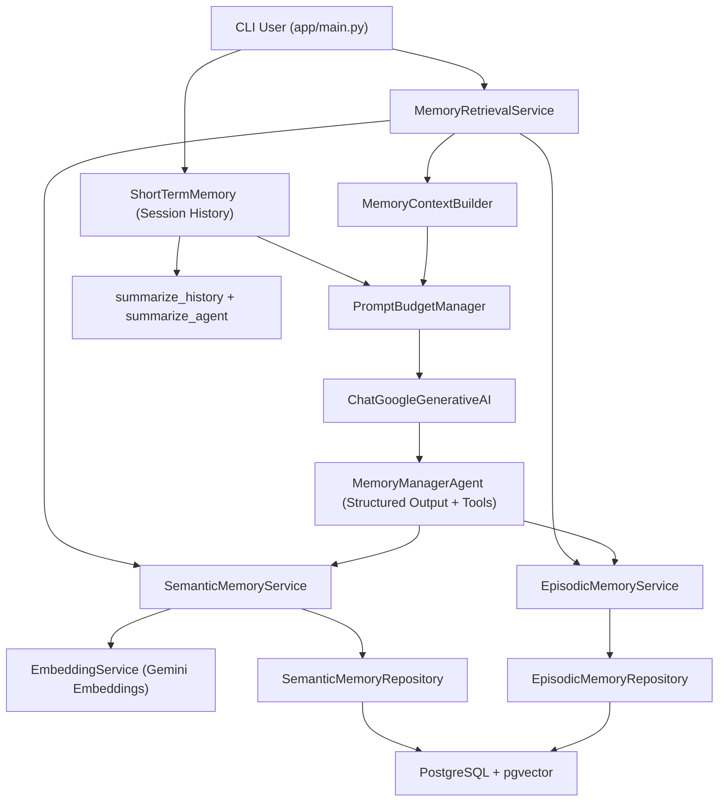
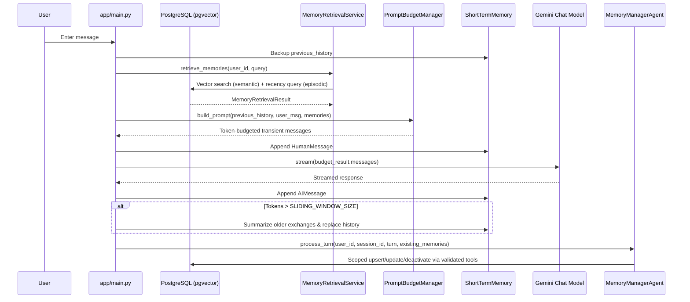

# Multi-Memory Assistant

An interactive CLI conversational assistant built with Python, LangChain, Google Gemini (`langchain-google-genai`), SQLAlchemy, and PostgreSQL (`pgvector`). It combines session-based short-term memory, sliding-window summarization, vector-backed semantic memory, recency-ordered episodic memory, unified prompt token budgeting, and an LLM-powered memory management agent.

## Architecture



### Memory Types

| Memory Type | Storage | Retrieval Strategy | Purpose |
| --- | --- | --- | --- |
| **Short-Term Memory** | In-memory (`ShortTermMemory`) | Per-session chronological list | Holds active conversation turns and rolling `"Conversation summary"` messages; isolated from retrieved long-term context. |
| **Semantic Memory** | PostgreSQL `semantic_memories` (`Vector(1536)`) | Cosine similarity via `pgvector` (`(memory, distance)`) + optional `max_distance`, `category`, and JSONB `metadata_json` filters | Durable facts, user preferences, technical skills, goals, projects, and decisions; supports soft deactivation (`is_active=False`) and conditional re-embedding on content updates. |
| **Episodic Memory** | PostgreSQL `episodic_memories` | Recency (`created_at DESC, id DESC`), optional session/event/metadata filters | Chronological summaries of significant conversation events and milestones. |

## Request Flow



If prompt assembly, streaming, or short-term summarization fails, `ShortTermMemory` rolls back to `previous_history`. Long-term memory extraction runs afterwards in an isolated database session so a failed memory write logs a warning without corrupting short-term history.

## Project Structure

```text
├── app/
│   ├── main.py                                 # CLI entry point (`uv run assistant`) and turn orchestration
│   ├── core/
│   │   ├── config.py                           # Environment & validation (`Settings`)
│   │   └── database.py                         # SQLAlchemy engine, `SessionLocal`, `get_db`, `get_db_session`
│   ├── agents/
│   │   ├── chat_agent.py                       # Gemini chat model factory
│   │   ├── summarize_agent.py                  # Structured conversation summarization agent
│   │   └── memory_agent.py                     # MemoryManagerAgent, Pydantic schemas, secret guard, scoped tools
│   ├── memory/
│   │   ├── short_term.py                       # Session-scoped short-term conversation store
│   │   ├── semantic.py                         # SemanticMemoryService (lifecycle, search, upsert, soft delete)
│   │   ├── episodic.py                         # EpisodicMemoryService (create, duplicate check, queries)
│   │   ├── retrieval.py                        # MemoryRetrievalService coordinating semantic & episodic stores
│   │   └── context_builder.py                  # Prioritization, cross-store deduplication, formatting, token budget
│   ├── models/
│   │   ├── semantic_memory.py                  # `SemanticMemory` ORM model (`Vector(1536)`)
│   │   └── episodic_memory.py                  # `EpisodicMemory` ORM model
│   ├── repositories/
│   │   ├── semantic_memory_repository.py       # Semantic CRUD, soft deactivation, cosine distance search
│   │   └── episodic_memory_repository.py       # Episodic CRUD, session/user queries, duplicate lookup
│   ├── services/
│   │   └── embedding_service.py                # Google GenAI document & query embedding wrapper
│   └── utils/
│       ├── chat_services.py                    # Sliding-window history summarization
│       └── prompt_budget.py                    # Unified prompt token budget allocation & overflow protection
├── migrations/                                 # Alembic migrations (`pgvector` extension + tables)
├── scripts/
│   └── manual_semantic_memory_repository.py    # Live PostgreSQL + Gemini verification script
└── tests/                                      # Automated mocked unit & integration test suite
```

## Setup

1. **Install dependencies** (requires Python `>=3.14` and [`uv`](https://docs.astral.sh/uv/)):

   ```bash
   uv sync
   ```

2. **Configure environment variables**:

   Copy `.env.example` to `.env` and set your own credentials (never commit `.env` or real API keys):

   ```bash
   cp .env.example .env
   ```

   | Variable | Default | Description |
   | --- | --- | --- |
   | `GEMINI_API_KEY` | *(required)* | Google Gemini API key |
   | `CHAT_MODEL` | `gemini-2.5-flash` | Gemini model used for chat, summarization, and memory classification |
   | `EMBEDDING_MODEL` | `gemini-embedding-001` | Gemini embedding model used by `EmbeddingService` |
   | `EMBEDDING_DIMENSION` | `1536` | Vector dimension validated against the `pgvector` schema contract |
   | `DATABASE_URL` | *(required for DB)* | PostgreSQL URL, e.g. `postgresql+psycopg://<user>:<pass>@localhost:5432/multi_memory` |
   | `CLI_USER_ID` | *(prompted if unset)* | Development user ID for scoping CLI memories |
   | `CLI_SESSION_ID` | `cli-session` | Default session ID for short-term and episodic memory |
   | `SLIDING_WINDOW_SIZE` (or `SLIDING_WIN_SIZE`) | `500` | Token threshold that triggers short-term history compression |
   | `MAX_PROMPT_TOKENS` | `4000` | Total prompt token ceiling (input + reserved response) |
   | `RESPONSE_RESERVE_TOKENS` | `1000` | Tokens reserved for the assistant reply |
   | `MEMORY_CONTEXT_MAX_TOKENS` | `1000` | Maximum tokens allocated to injected long-term memories |
   | `SEMANTIC_RETRIEVAL_LIMIT` | `5` | Number of semantic memories fetched per turn |
   | `EPISODIC_RETRIEVAL_LIMIT` | `5` | Number of episodic memories fetched per turn |
   | `SEMANTIC_MAX_DISTANCE` | *(unset)* | Optional cosine distance cutoff (`0.0` to `2.0`) |

3. **Run database migrations** (PostgreSQL with `pgvector` enabled):

   ```bash
   uv run alembic upgrade head
   ```

## Usage

Start the interactive CLI (uses `CLI_USER_ID` from `.env`, `--user-id`, or prompts interactively):

```bash
uv run assistant --user-id dev-user-001 --session-id session-1
```

Type `exit`, `quit`, or `bye` to end the session.

## Testing

### Unit & Integration Tests (Mocked)

Automated tests mock Gemini LLM/embedding calls and database sessions so they run fast and offline without mutating production data:

```bash
uv run pytest -v
```

### Live Integration Verification

Live verification scripts call the configured PostgreSQL database and Google Gemini APIs directly (requires valid `.env` credentials and migrated tables):

```bash
uv run python -m tests.test_embedding_service
uv run python -m scripts.manual_semantic_memory_repository
```

## Current Limitations

- **Episodic memories are recency-only**: The `episodic_memories` table does not yet store embeddings or an `is_active` column, so episodic retrieval sorts by recency and episodic records are append-only (with duplicate-summary prevention).
- **Fixed `1536` embedding dimension**: `Settings` enforces `EMBEDDING_DIMENSION=1536` to match the existing Alembic migration (`Vector(dim=1536)`).
- **Clearing nullable fields on update**: `SemanticMemoryRepository.update()` currently treats `None` as "leave unchanged", so explicitly clearing nullable fields to `NULL` will require a sentinel value in a future iteration.
- **No configured linter/type-checker**: `pyproject.toml` currently configures `pytest` only (`ruff`/`mypy` are not configured).
