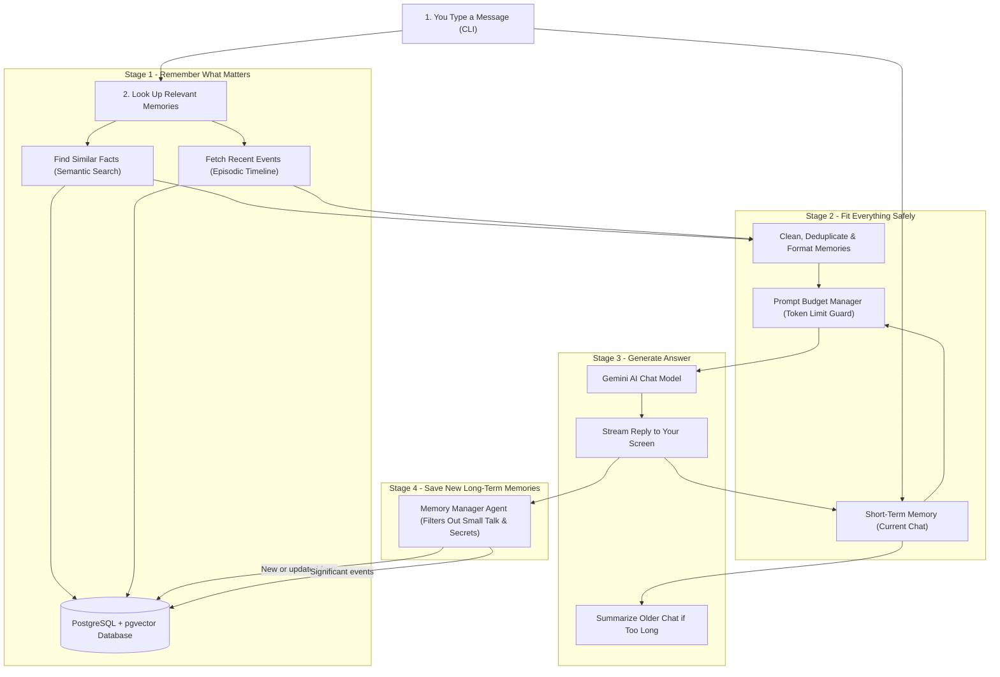
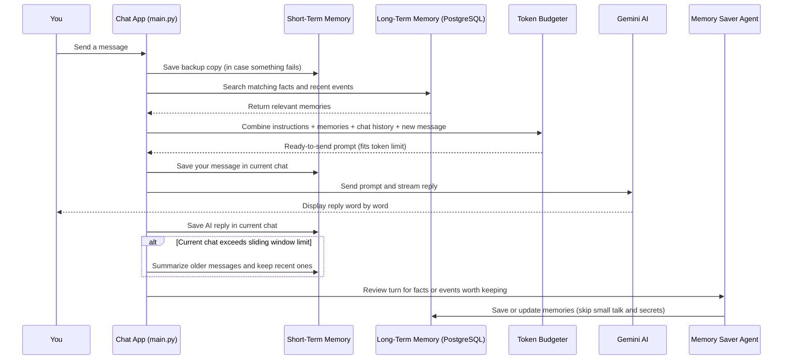
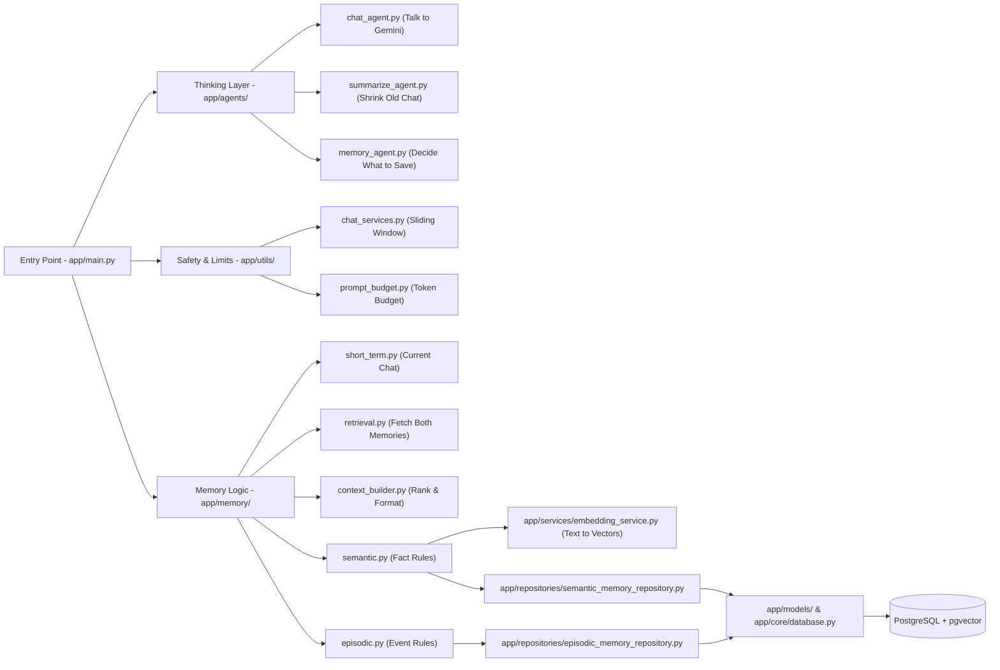

# Multi-Memory Assistant

An interactive AI chat assistant that remembers your conversations like a human does—keeping track of the **current chat**, **long-term facts about you**, and **important past events**, even across separate sessions.

Built with Python, LangChain, Google Gemini (`langchain-google-genai`), SQLAlchemy, and PostgreSQL (`pgvector`).

---

## How It Works (In Plain English)

Most simple chatbots forget everything the moment you close the window. This assistant solves that using **three separate types of memory**, each with its own job:

| Memory Type | Human Analogy | What It Stores | Where It Lives |
| --- | --- | --- | --- |
| **Short-Term Memory** | *Working memory ("Right now")* | Messages from the current chat session; automatically summarizes older messages if the chat gets too long | In app memory (`ShortTermMemory`) |
| **Semantic Memory** | *Long-term knowledge ("Facts about you")* | Your name, skills, preferences, goals, active projects, and decisions; searched by **meaning** | PostgreSQL `semantic_memories` (`pgvector`) |
| **Episodic Memory** | *Diary / timeline ("Things that happened")* | Important milestones, session events, and key decisions; recalled from **newest to oldest** | PostgreSQL `episodic_memories` |

---

## App Architecture & Flow Diagrams

### 1. Big-Picture Architecture

Every time you send a message, it moves through four simple stages—**Look Up**, **Pack Within Token Limit**, **Answer**, and **Remember**:



### 2. Step-by-Step Conversation Flow

Here is what happens behind the scenes for a single message:



> **Safety net:** If the AI reply or chat summarization fails, your current chat rolls back cleanly to before your message. Long-term memory saving runs separately at the end, so even if saving a memory fails, your conversation is never lost.

---

## Visual App Structure

Each folder in `app/` has a single, clear responsibility—data flows from the user screen on the left down to the database on the right:



### Folder Breakdown

```text
├── app/
│   ├── main.py                                 # Starts the CLI (`uv run assistant`) and runs each chat turn
│   ├── core/
│   │   ├── config.py                           # Loads and validates `.env` settings (`Settings`)
│   │   └── database.py                         # Connects to PostgreSQL and manages DB sessions (`get_db`, `get_db_session`)
│   ├── agents/
│   │   ├── chat_agent.py                       # Creates the Gemini chat model
│   │   ├── summarize_agent.py                  # Summarizes older messages while keeping key facts
│   │   └── memory_agent.py                     # Decides what to save/update/deactivate and blocks secrets/PII
│   ├── memory/
│   │   ├── short_term.py                       # Stores messages for the active chat session
│   │   ├── semantic.py                         # Validates, deduplicates, searches, updates, and soft-deletes facts
│   │   ├── episodic.py                         # Validates, deduplicates, and fetches event summaries
│   │   ├── retrieval.py                        # Fetches semantic matches + recent episodic events together
│   │   └── context_builder.py                  # Ranks, deduplicates, formats, and budgets retrieved memories
│   ├── models/
│   │   ├── semantic_memory.py                  # Database table definition for semantic memories (`Vector(1536)`)
│   │   └── episodic_memory.py                  # Database table definition for episodic memories
│   ├── repositories/
│   │   ├── semantic_memory_repository.py       # SQL queries for semantic memories & pgvector cosine similarity
│   │   └── episodic_memory_repository.py       # SQL queries for episodic memories
│   ├── services/
│   │   └── embedding_service.py                # Converts text into 1536-dimension Gemini vector embeddings
│   └── utils/
│       ├── chat_services.py                    # Compresses older chat history when it crosses the window limit
│       └── prompt_budget.py                    # Ensures total prompt + reserved reply never exceed token limits
├── migrations/                                 # Alembic database migrations (`pgvector` + tables)
├── scripts/
│   └── manual_semantic_memory_repository.py    # Live PostgreSQL + Gemini verification script
└── tests/                                      # Automated mocked unit & integration tests (256 tests)
```

---

## Setup

1. **Install dependencies** (requires Python `>=3.14` and [`uv`](https://docs.astral.sh/uv/)):

   ```bash
   uv sync
   ```

2. **Configure environment variables**:

   Copy `.env.example` to `.env` and fill in your credentials (never commit `.env` or real API keys):

   ```bash
   cp .env.example .env
   ```

   | Variable | Default | Description |
   | --- | --- | --- |
   | `GEMINI_API_KEY` | *(required)* | Google Gemini API key |
   | `CHAT_MODEL` | `gemini-2.5-flash` | Gemini model used for chat, summarization, and memory classification |
   | `EMBEDDING_MODEL` | `gemini-embedding-001` | Gemini embedding model used by `EmbeddingService` |
   | `EMBEDDING_DIMENSION` | `1536` | Vector dimension validated against the `pgvector` schema contract |
   | `DATABASE_URL` | *(required for DB)* | PostgreSQL URL, e.g. `postgresql+psycopg://<user>:<pass>@localhost:5432/multi_memory` |
   | `CLI_USER_ID` | *(prompted if unset)* | Development user ID for scoping CLI memories |
   | `CLI_SESSION_ID` | `cli-session` | Default session ID for short-term and episodic memory |
   | `SLIDING_WINDOW_SIZE` (or `SLIDING_WIN_SIZE`) | `500` | Token threshold that triggers short-term history compression |
   | `MAX_PROMPT_TOKENS` | `4000` | Total prompt token ceiling (input + reserved response) |
   | `RESPONSE_RESERVE_TOKENS` | `1000` | Tokens reserved for the assistant reply |
   | `MEMORY_CONTEXT_MAX_TOKENS` | `1000` | Maximum tokens allocated to injected long-term memories |
   | `SEMANTIC_RETRIEVAL_LIMIT` | `5` | Number of semantic memories fetched per turn |
   | `EPISODIC_RETRIEVAL_LIMIT` | `5` | Number of episodic memories fetched per turn |
   | `SEMANTIC_MAX_DISTANCE` | *(unset)* | Optional cosine distance cutoff (`0.0` to `2.0`) |

3. **Run database migrations** (PostgreSQL with `pgvector` enabled):

   ```bash
   uv run alembic upgrade head
   ```

## Usage

Start the interactive CLI (uses `CLI_USER_ID` from `.env`, `--user-id`, or prompts interactively):

```bash
uv run assistant --user-id dev-user-001 --session-id session-1
```

Type `exit`, `quit`, or `bye` to end the session.

## Testing

### Unit & Integration Tests (Mocked)

Automated tests mock Gemini LLM/embedding calls and database sessions so they run fast and offline without mutating production data:

```bash
uv run pytest -v
```

### Live Integration Verification

Live verification scripts call the configured PostgreSQL database and Google Gemini APIs directly (requires valid `.env` credentials and migrated tables):

```bash
uv run python -m tests.test_embedding_service
uv run python -m scripts.manual_semantic_memory_repository
```

## Current Limitations

- **Episodic memories are recency-only**: The `episodic_memories` table does not yet store embeddings or an `is_active` column, so episodic retrieval sorts by recency and episodic records are append-only (with duplicate-summary prevention).
- **Fixed `1536` embedding dimension**: `Settings` enforces `EMBEDDING_DIMENSION=1536` to match the existing Alembic migration (`Vector(dim=1536)`).
- **Clearing nullable fields on update**: `SemanticMemoryRepository.update()` currently treats `None` as "leave unchanged", so explicitly clearing nullable fields to `NULL` will require a sentinel value in a future iteration.
- **No configured linter/type-checker**: `pyproject.toml` currently configures `pytest` only (`ruff`/`mypy` are not configured).
